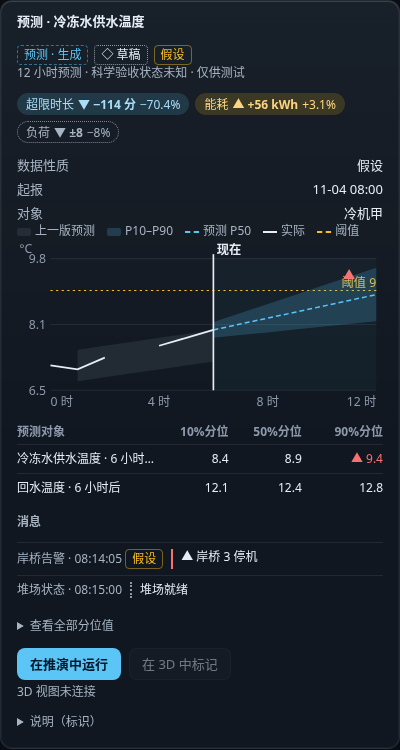
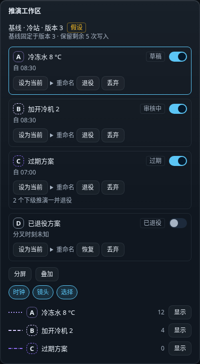
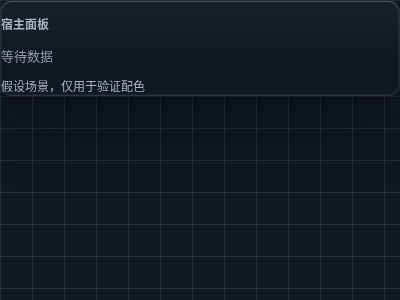

# OPS subject 模型样式参考：公开镜像

Apps 已明确授权安全公开本正文及以下三张 synthetic PNG。只读取/核查这份文档与明确链接的三图；未复制 SDK 代码、字体或其他资源，未改权限。图像目视为合成假设夹具，未见客户、个人或 LIVE 内容；这不是完成的模型或播放器材质验证。

- 原文：[MODEL-STYLE-REF.md 精确提交](https://github.com/hsudatalks/univers-aip-lib-ts-reality-extension-sdk/blob/f5594f0a91e9f843f1e76b6295ff910f2cdddcaa/packages/capability-contract/docs/MODEL-STYLE-REF.md)。文档 commit `f5594f0a91e9f843f1e76b6295ff910f2cdddcaa`；原始文档字节 SHA256 `b40dd9a1eff3bb4c6964807c7e6cee89072f9c16500eb97dbdc65823b0afccbd`。
- baseline及包信息沿下方原文保留；未另取 npm 包、CSS、scene JSON 或 references 清单实核。原文 token 数值与未验证 PBR 警示保留，仅将相对链接改为固定来源/镜像图路径，并增加本来源说明。
- ready/active 使用蓝色 accent；不以旧 green aliases 作为新模型参考。CSS glass 与 Blender PBR 的一致性未验证。公开本文不修改资产许可。

| 原图来源（同一文档 commit） | 原始 bytes | 原始/镜像 SHA256 |
| --- | ---: | --- |
| [model-style-panel.png](https://github.com/hsudatalks/univers-aip-lib-ts-reality-extension-sdk/blob/f5594f0a91e9f843f1e76b6295ff910f2cdddcaa/packages/capability-contract/docs/model-style-ref/model-style-panel.png) | 70921 | `7828840024576d74d375fd6350d49ef8d99a34728b2e2d686859ed22e9ad5151` |
| [model-style-workspace.png](https://github.com/hsudatalks/univers-aip-lib-ts-reality-extension-sdk/blob/f5594f0a91e9f843f1e76b6295ff910f2cdddcaa/packages/capability-contract/docs/model-style-ref/model-style-workspace.png) | 66051 | `830832adc6b147adf6378cd2131d3d72e25760ea9aaa21a95aabf367eb871432` |
| [model-style-glass.png](https://github.com/hsudatalks/univers-aip-lib-ts-reality-extension-sdk/blob/f5594f0a91e9f843f1e76b6295ff910f2cdddcaa/packages/capability-contract/docs/model-style-ref/model-style-glass.png) | 11452 | `330963ec197ecca01cb2d8a3f39012979c7400ce447b88ef3667f74504ecd0f7` |

以下为保留数值的原文镜像。

---

# Reality 模型风格参考

供外部 Blender 建模师制作频道枢纽、决策、告警、任务、消息等 operation-subject 概念模型。本文只给配色、材质与标签风格，具体造型和语义由模型设计定义。

基准：`@univers/capability-contract@0.1.0-dev.cc-1.11.1`；源码 `fb61b934a2cf70a34b11406c040dbd4231a14cb3`；包 SHA256 `3a5f2b77e04114b7835a18662d0b5fb21bfb1ba1811161679e95f6527b449dc3`。数值取自同版本 [tokens.css](https://github.com/hsudatalks/univers-aip-lib-ts-reality-extension-sdk/blob/f5594f0a91e9f843f1e76b6295ff910f2cdddcaa/packages/capability-contract/css/tokens.css)、[kit.css](https://github.com/hsudatalks/univers-aip-lib-ts-reality-extension-sdk/blob/f5594f0a91e9f843f1e76b6295ff910f2cdddcaa/packages/capability-contract/css/kit.css) 与 [scene.json](https://github.com/hsudatalks/univers-aip-lib-ts-reality-extension-sdk/blob/f5594f0a91e9f843f1e76b6295ff910f2cdddcaa/packages/capability-contract/tokens/scene.json)。这是4887衍生的深色套件；没有单独的浅色主题 token。降低透明度偏好使用下面的深色实色值。

## 调色板：源色为 sRGB

| 用途 | 现有 token | 精确 hex | 使用说明 |
|---|---|---|---|
| 最底层背景 | --rui-surface-base | #0b0f14 | 深色背景、外壳实色 |
| 主要表面 | --rui-surface-solid / --rui-surface-panel | #111821 | 模型主体的深色基调、面板实色 |
| 卡片 / 浮层实色 | --rui-surface-card | #162030 | 次级体块、浮层实色 |
| 抬升表面 | --rui-surface-raised | #1d2a3b | 局部层次，不用纯黑填满所有面 |
| 强调 / active / ready | --rui-accent | #5bc5f5 | 当前、选中、就绪；适合小面积边缘或状态节点 |
| idle | --rui-status-idle | #8b98a9 | 中性状态图形；标签仍用正文墨色 |
| 警告 | --rui-status-warning | #fbbf24 | 提醒、待处理；配合形状 |
| alert / critical | --rui-status-critical | #f87171 | 告警，配合三角或明确标记 |
| info | --rui-status-info | #60a5fa | 信息性质、说明性状态 |
| 表面主文字 | --rui-text-1 | #e6edf5 | 名称、主要标签、徽标字母 |
| 表面次文字 | --rui-text-2 | #a7b4c4 | 次标签、说明；当前有界玻璃的说明文字使用此色 |
| 强调色上的文字 | --rui-text-on-accent | #04182a | 蓝色实心面上的深色文字 |
| 细边框源色 | --rui-border-subtle | #94a3b8，alpha0.14 | 完整值为rgba(148,163,184,0.14) |
| 强边框 | --rui-border-strong | #7d8a9c | 边缘层次；不作小字号主要文字 |
| 场景天空 / 雾 | --scene-sky / --scene-fog | #111821 | 与UI同一暗底 |
| 场景环境光参考 | --scene-ambient | #a7b4c4 | 场景基调参考 |
| 场景网格 | --scene-grid | #94a3b8，alpha0.14 | 克制的背景线条 |

Active/ready 沿用当前组件的蓝色 accent。历史 CSS 中保留的 status-ok/running/success 绿色别名用于兼容；新模型不使用这些绿色别名。字体颜色不要用透明度降低整组内容来模拟“次要”。

推演的三个图形槽位是 --viz-whatif `#b49cff`、--viz-whatif-2 `#d9ccff`、--viz-whatif-3 `#8e6cf2`。它们只用于推演图形或叠加层；字母仍用 --rui-text-1。操作对象的常态材质保持上表的中性色与状态色。

## 磨砂玻璃：UI 的精确参数

| 层 | tint 与 alpha | blur | saturation | border |
|---|---|---|---|---|
| shell | --re-shell-fill: rgba(11,15,20,.56)，hex#0b0f14 | 20px | 120% | 1px solid rgba(148,163,184,0.14) |
| panel | --re-panel-fill: rgba(17,24,33,.64)，hex#111821 | 18px | 120% | 1px solid rgba(148,163,184,0.14) |
| floating | --re-floating-fill: rgba(22,32,48,.76)，hex#162030 | 20px | 125% | 1px solid #7d8a9c |
| embedded / 显式有界表面 | --re-panel-fill-embedded: rgba(17,24,33,.9) | 保留所属层的blur | 保留所属层的saturation | 保留所属层的边框 |

表面声明 data-contrast-bound 时，现有嵌入填充与 panel 顶光才用于该有界表面；旧玻璃仍是默认。降低透明度偏好下，shell/panel/floating 的实色分别为 #0b0f14 / #111821 / #162030。

顶光的渐变方向均为180deg，白色衰减到60%位置的透明：

| token | 精确值 |
|---|---|
| --re-shell-toplight | linear-gradient(180deg,rgba(255,255,255,.035),rgba(255,255,255,0) 60%) |
| --re-panel-toplight | linear-gradient(180deg,rgba(255,255,255,.04),rgba(255,255,255,0) 60%) |
| --re-floating-toplight | linear-gradient(180deg,rgba(255,255,255,.05),rgba(255,255,255,0) 60%) |

高光与阴影：

| 层 | highlight | shadow |
|---|---|---|
| shell | inset 0 1px 0 rgba(255,255,255,.10), inset 0 0 0 1px rgba(255,255,255,.04) | 0 2px 8px rgba(1,7,18,.12), 0 12px 32px rgba(1,7,18,.22) |
| panel | inset 0 1px 0 rgba(255,255,255,.12), inset 0 0 0 1px rgba(255,255,255,.04) | 0 2px 6px rgba(1,7,18,.14), 0 16px 48px rgba(1,7,18,.28) |
| floating | inset 0 1px 0 rgba(255,255,255,.16), inset 0 0 0 1px rgba(255,255,255,.05) | 0 2px 8px rgba(1,7,18,.16), 0 24px 64px rgba(1,7,18,.36) |

圆角：panel12px、control8px；它们是屏幕空间UI参数。建模时按物件尺度保持柔和倒角，不把CSS像素换算成固定世界尺寸。

## Blender PBR 起点：由 UI token 推导的建议，未经材质测量

建议使用 Principled BSDF 的薄壳或轻倒角体块。以下数值用于首轮试做；UI alpha、背景模糊与PBR透射是不同参数。

| 参数 | 建议起点 |
|---|---|
| Base Color | 通过sRGB颜色输入 #111821；次级面可用 #162030 |
| Metallic | 0 |
| Roughness | 0.28；试做范围0.20–0.40，保留柔化反射 |
| Transmission Weight | 0.30；试做范围0.15–0.45 |
| Alpha | 1，先以透射调整玻璃；需要薄片透明方案时另行校对其排序与背面 |
| IOR | 1.45 |
| active 小区域 emission | #5bc5f5，strength起点0.4，试做范围0.2–1.0 |
| alert 小区域 emission | #f87171，strength起点0.6，试做范围0.3–1.2 |
| 光照与阴影 | 细窄顶侧高光、柔和接触阴影；按当前场景曝光校对，避免大面积自发光吞掉轮廓 |

上表的hex是UI源色。PBR经过光照、曝光与色调映射后的屏幕颜色需要对照下方截图调整。UI对比度证明不等于3D材质证明；标签与状态标志在最终播放器截图里另行验收。

## 字体与图标

- UI字体栈为 InterVariable, Inter, "PingFang SC", "Noto Sans SC", system-ui, sans-serif。常规400、强调600；数值使用tabular-nums lining-nums。
- UI标签12px/16px，正文13px/20px，标题16px/24px，主要指标28px/36px。模型标签按最终屏幕可读性缩放，使用主/次文字墨色与简短中文。
- 图标通常16px；通用token --rui-icon-stroke为1.75。现有kindGlyph使用24×24 viewBox、stroke1.6、圆端点与圆连接、currentColor单色线描、fill:none。模型细节应在小尺寸下保留清楚轮廓。
- 用字母、三角等既有形状辅助状态；不单靠颜色传递信息。对象ID、hash、UUID保留为元数据，不做主要表面文字。字体文件未随本文分发。

## 可外发视觉参考

以下是同版本SDK自有的合成gallery截图，均400px宽，已目视检查。数据为假设夹具，无客户数据、个人信息或LIVE内容；不是完成的operation-subject模型或真实现场截图。PNG可连同本文直接转交。渲染版本、来源视图和SHA256见[参考清单](https://github.com/hsudatalks/univers-aip-lib-ts-reality-extension-sdk/blob/f5594f0a91e9f843f1e76b6295ff910f2cdddcaa/packages/capability-contract/docs/model-style-ref/references.json)。

**面板、图表、状态标签与蓝色强调**

**当前态边框、控件与推演字母**

**显式有界玻璃叠在场景网格上**

